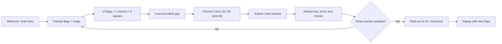
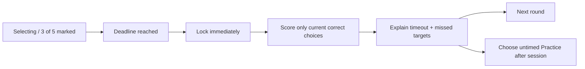
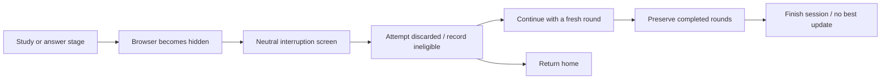

# User journeys for review

The interactive mockup has three review paths: first challenge, timeout, and interrupted session. It uses a fixed example with manual steps and sample clocks. [Open the interactive mockup](index.html).

## Flag presentation

During study, one large national flag fills the center of a flat charcoal field. Pass and flag counters sit above the field. After the five-second gap, 25 flag images form a tight 5×5 grid. The timer and selection count sit above the board. A mint outline and checkmark show selections without moving the images.

The user’s reference images informed scale and spacing. The demo uses its own board arrangement, includes Nicaragua as the first study example, and places similar designs such as Nicaragua and El Salvador on the board. Each flag keeps its source proportions. Equal board cells fit the entire image, with charcoal space where the aspect ratios differ. Country names appear in the review, where the player can also open the original study sequence.

## 1. First challenge: understand → observe → recognize → learn

In the mockup, use **Next flag** to view the sequence or choose **Choose five** in the screen picker to jump to the board. Submit five flags to see which choices matched and which targets you missed.

## 2. Time expires with partial choices

Review focus: a timeout is a scored outcome, not an error modal. No guessing after time expires and no duplicate score if Submit is clicked at the boundary.

## 3. Player switches apps during study

Review focus: explain the consequence kindly; do not reveal the sequence, resume a stale timer or quietly award a record. Practice also restarts the interrupted round, without competitive consequences.

## Replay and practice

Results → Play again creates a new seed with the same rules. Results → Practice keeps the 10/25/5 task, doubles exposure to two seconds per flag and removes the answer deadline. A named/described option supports a different memory experience and remains separate from standard records.
