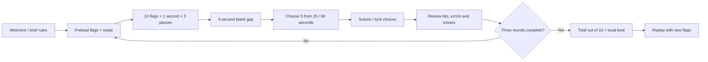
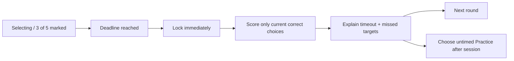
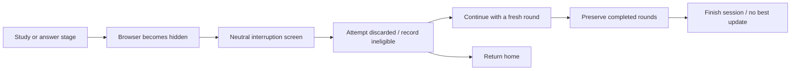

# User journeys for review

[Open the interactive mockup](index.html). The screens use a fixed example and manual steps; they demonstrate layout and transitions, not elapsed time or a completed game. Screens include welcome, memorize, blank interval, choice grid, round feedback, final score and interruption. Three review paths are available: first challenge, timeout, and interrupted session.

## 1. First challenge: understand → observe → recognize → learn

Review focus: the board must not look like a country-name quiz or a face-down pair game. Keep only one flag on screen during study. Show the selection cap, remaining time and clear next action.

## 2. Time expires with partial choices

Review focus: a timeout is a scored outcome, not an error modal. No guessing after time expires and no duplicate score if Submit is clicked at the boundary.

## 3. Player switches apps during study

Review focus: explain the consequence kindly; do not reveal the sequence, resume a stale timer or quietly award a record. Practice also restarts the interrupted round, without competitive consequences.

## Replay and practice

Results → Play again creates a new seed with the same rules. Results → Practice keeps the 10/25/5 task, doubles exposure to two seconds per flag and removes the answer deadline. A named/described option supports a different memory experience and remains separate from standard records.
